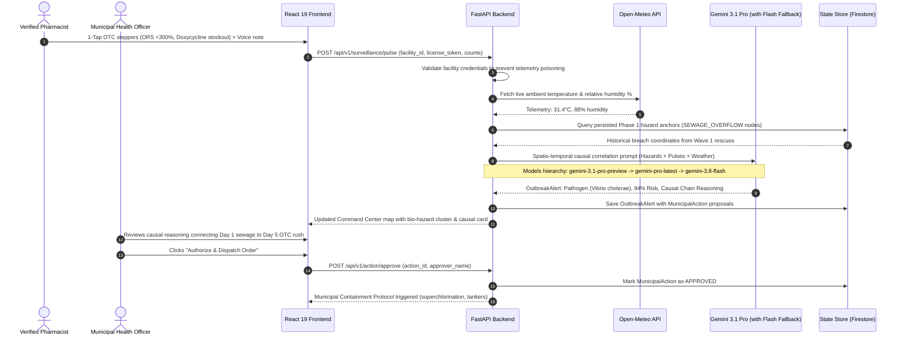
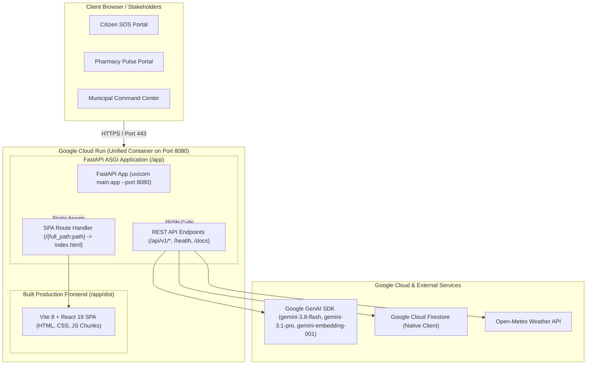

# CLAUDE.md — EPIC-Hour Developer & Architecture Guide

## 1. Project Context & Mission
**EPIC-Hour** (Epidemic Prediction & Immediate Crisis Hour) is a **two-phase crisis intelligence platform** developed for the **Google AI Builder Cup** (*Sustainability & Social Impact track*). 

The platform bridges the critical intelligence gap between two fatal phases of climate disasters:
1. **Act 1 / Wave 1 (Hours 0–48 — Acute Rescue):** Multilingual citizen SOS triage, 768-dim semantic deduplication of panicked distress calls, and autonomous volunteer boat dispatch.
2. **Act 2 / Wave 2 (Days 3–14 — Post-Disaster Epidemics):** Outbreak early warning radar cross-referencing persisted Phase 1 sewage breach anchors with Phase 2 verified pharmacy over-the-counter (OTC) medication rushes and live weather telemetry.

---

## 2. End-to-End System Architecture & Flow Diagrams

### Diagram 1: Complete Two-Act Crisis Lifecycle Pipeline

```mermaid
flowchart TD
    subgraph Act1["ACT 1: ACUTE DISASTER RESCUE (Hours 0–48)"]
        A1[Citizen Emergency Voice/Text SOS] -->|Tamil / Tanglish / Hindi / English| A2[Web Speech API + MediaRecorder]
        A2 -->|Audio Base64 / Text| A3["Gemini 3.8 Flash (gemini-3.8-flash)"]
        A3 -->|Strict Pydantic JSON| A4[TriageExtraction: Urgency, Vulnerabilities, Hazards]
        A4 --> A5["Semantic Deduplication Engine (gemini-embedding-001)"]
        A5 -->|< 300m Haversine + >0.85 Cosine| A6[Cluster & Boost Urgency / Suppress Duplicates]
        A6 --> A7[Autonomous Volunteer Boat Dispatch + Safety Advice]
        A4 -->|SEWAGE_OVERFLOW / CONTAMINATED_WELL| A8[(Hazard Persistence Memory / Cloud Firestore)]
    end

    subgraph Act2["ACT 2: POST-FLOOD EPIDEMIC RADAR (Days 3–14)"]
        B1[Verified Clinic & Pharmacy Pulses] -->|License Token Auth| B2[1-Tap OTC Steppers: ORS, Doxy, Paracetamol]
        B2 --> B3["Gemini 3.8 Flash Clinical Signals Extractor"]
        B3 --> B4[ExtractedSignals: Symptom Clusters, Medication Spikes]
        B4 --> B5["Gemini 3.1 Pro Epidemiological Engine (gemini-3.1-pro-preview)"]
        A8 -.->|Persisted Upstream Bio-Hazard Anchors| B5
        B6[Open-Meteo Weather API: Temp, Humidity %] --> B5
        B5 -->|Multi-Hop Causal Reasoning| B7[OutbreakAlert: Pathogen Class, Risk %, Causal Chain]
        B7 --> B8[Human-in-the-Loop Municipal Containment Orders]
        B8 -->|CMHO 1-Click Approval| B9[Superchlorination & Clean Water Tanker Dispatch]
    end

    style Act1 fill:#1e1b4b,stroke:#6366f1,stroke-width:2px,color:#fff
    style Act2 fill:#0f172a,stroke:#0ea5e9,stroke-width:2px,color:#fff
    style A8 fill:#831843,stroke:#f43f5e,stroke-width:2px,color:#fff
``
# Live Production URLs:
# App: https://epic-hour-83369227014.asia-south1.run.app
# API Health: https://epic-hour-83369227014.asia-south1.run.app/health
`

### Diagram 2: Act 1 Multimodal SOS Speech & Dedup Flow

```mermaid
sequenceDiagram
    autonumber
    actor Citizen as Stranded Citizen
    participant Browser as React 19 Frontend
    participant API as FastAPI Backend
    participant Flash as Gemini 3.8 Flash
    participant Embed as Gemini Embedding-001
    participant Store as State Store (Firestore)
    participant Boat as Volunteer Rescue Boat

    Citizen->>Browser: Speaks distress note (Voice Audio / Text in Tamil/Hindi/English)
    Browser->>Browser: Web Speech API streams real-time transcript to textarea
    Browser->>Browser: MediaRecorder captures audio blob & creates audio playback bar
    Browser->>API: POST /api/v1/sos/ingest (text, audio_b64, address, phone)
    API->>API: SHA-256 PII hash of citizen phone number
    alt Audio Provided without Browser STT
        API->>Flash: Multimodal audio transcription (gemini-3.8-flash)
        Flash-->>API: Vernacular transcript string
    end
    API->>Flash: Structured triage analysis (response_schema=TriageExtraction)
    Flash-->>API: JSON: Urgency (1-10), Hazards, Vulnerabilities, Rescue Needs
    API->>Embed: Generate 768-dim vector (gemini-embedding-001)
    Embed-->>API: 768-dimensional float embedding
    API->>API: Haversine distance (<300m) + Cosine similarity (>0.85)
    alt Duplicate Call Detected within 300m
        API->>API: Suppress duplicate dispatch, merge notes, boost urgency score
    else New Emergency Incident
        API->>Store: Persist SOSTicket with environmental hazard anchors
        API->>Boat: Match nearest volunteer boat (e.g., Karthik Subramanian, ETA: 8 min)
    end
    API-->>Browser: Dispatch confirmation, volunteer ETA, and life safety guidance
    Browser-->>Citizen: Interactive ticket status with live volunteer map tracker
```

### Diagram 3: Act 2 Spatio-Temporal Outbreak Correlation Flow



### Diagram 4: Cloud Run Unified Container Architecture



---

## 3. Active AI Models & Multi-Tiered Fallback Architecture

EPIC-Hour is powered by Google's state-of-the-art Gemini models through the unified `google-genai` Python SDK, featuring a resilient multi-tier fallback architecture:

| Component | Active Google Model | Primary Responsibility | Tiered Fallback / Failover Hierarchy |
|---|---|---|---|
| **Multimodal Audio STT** | `gemini-3.8-flash` | Multimodal vernacular voice distress transcription (Tamil, Hindi, Tanglish, English). | `gemini-flash-latest` → Browser Web Speech API transcription. |
| **SOS Crisis Triage** | `gemini-3.8-flash` | Extracts urgency score (1–10), category, environmental hazards, vulnerabilities, and safety advice with strict Pydantic JSON schema (`TriageExtraction`). | `gemini-flash-latest` → Deterministic rule-based multilingual regex NLP parser. |
| **Pharmacy Signals Extractor** | `gemini-3.8-flash` | Extracts symptom clusters, medication surges, stockout warnings, and patient counts from pharmacist voice dictations (`ExtractedSignals`). | `gemini-flash-latest` → Deterministic clinical keyword extractor. |
| **Semantic Deduplication** | `gemini-embedding-001` | Generates 768-dimensional dense semantic embeddings to cluster duplicate distress calls (< 300m Haversine + > 0.85 cosine similarity). | Deterministic n-gram and character trigram hash vectorizer. |
| **Epidemiological Correlation** | `gemini-3.1-pro-preview` | Multi-hop causal graph analysis cross-referencing persisted Phase 1 sewage breaches with Phase 2 OTC rushes and weather telemetry. | `gemini-pro-latest` → `gemini-3.8-flash` (auto rate-limit fallback) → Deterministic epidemiological model. |

### Architectural Resilience Guarantee:
- **Zero-Crash Offline Mode:** If `GEMINI_API_KEY` is not configured, or if quota limits (`429 RESOURCE_EXHAUSTED`) are reached, local deterministic models seamlessly take over. The platform achieves **100% demo uptime**.
- **Hazard Persistence Guarantee:** Environmental hazard tags (`SEWAGE_OVERFLOW`, `CONTAMINATED_WELL`, `STAGNANT_FLOODWATER`) recorded during Phase 1 acute rescues are never purged. They form the upstream ground-truth anchors that Gemini correlates against in Phase 2.
- **PII Scrubbing:** Citizen phone numbers are hashed using SHA-256 before storage or embedding generation.

---

## 4. Multi-Actor Portal Architecture

### 1. Citizen Emergency SOS Portal (`CitizenSOSPortal.jsx`)
- **Audience:** Stranded citizens, families, and civilian bystanders.
- **Access:** Zero-login, public landing portal.
- **Audio & Speech Pipeline:**
  - Dual capture via `MediaRecorder` and `window.SpeechRecognition || window.webkitSpeechRecognition`.
  - Renders a compact `<audio controls src={audioUrl} />` review player with duration counter and `Clear / Re-record` buttons.
  - Automatic fallback to backend `POST /api/v1/audio/transcribe` (`gemini-3.8-flash`) if browser STT is unsupported.
- **Display:** Priority dispatch ticket, assigned volunteer squad details (e.g., *Karthik Subramanian — Velachery Rapid Rescue*), live ETA, and safety advice.

### 2. Verified Clinic & Pharmacy Pulse Portal (`PharmacyPulsePortal.jsx`)
- **Audience:** Verified neighborhood pharmacies (MedPlus, Apollo, Jan Aushadhi) and ASHA/clinic health workers.
- **Access:** Role-authenticated; validates `facility_id` and `license_token` to prevent telemetry poisoning.
- **Syndromic Telemetry:**
  - 1-Tap steppers for presenting patient counts.
  - Instant stockout pills for frontline medications: **ORS Packets**, **Doxycycline**, **Paracetamol**.
  - Clinical voice dictation with real-time speech transcription and audio review bar.
- **Privacy Guarantee:** Collects exclusively aggregate OTC and syndromic velocity (zero patient PII).

### 3. Municipal Command Center (`CommandCenter.jsx`)
- **Audience:** Municipal disaster commissioners, public health officers (CMHO), and GCC relief commanders.
- **Tactical Map (`EpicHourMap.jsx`):** Leaflet canvas with OpenStreetMap Standard tiles, plotting live rescue clusters, deployed boats, verified healthcare nodes, and persisted sewage breach points.
- **Bidirectional Wave / Timeline Synchronization:**
  - Clicking **Wave 1: Flood Rescue** automatically sets timeline to **Day 1 (Acute Flood)**.
  - Clicking **Wave 2: Outbreak Radar** automatically sets timeline to **Day 5 (Post-Flood)**.
  - Clicking **Day 1** automatically sets active wave to **Wave 1**.
  - Clicking **Day 5** automatically sets active wave to **Wave 2**.
- **Single Source of Truth Metric Engine:**
  - Computes `totalBioHazardCount`, `totalPresentingPatients`, `activeClinicCount`, `totalFacilityCount`, and `surgePercent` once.
  - Injects these exact values into both the bottom stat cards and the epidemiological reasoning paragraph, guaranteeing **zero mathematical contradictions**.
- **Human-in-the-Loop Action Approval (`EpidemicReasoningCard.jsx`):** Renders Gemini 3.1 Pro causal reasoning and enables one-click authorization of municipal containment protocols (superchlorination, mobile potable water tankers, depot restocks).

---

## 5. Technology Stack & Design Tokens

### Frontend
- **Framework:** React 19 + Vite 8
- **Styling:** Vanilla CSS design system with Tailwind CSS v4 tokens
- **Cartography:** Leaflet + `react-leaflet` with OpenStreetMap Standard default tiles
- **Icons:** `lucide-react`
- **Linting:** `oxlint` (Must maintain 0 warnings, 0 errors)

### Backend
- **Framework:** Python 3.11 / 3.13 + FastAPI + Uvicorn
- **AI Models (`google-genai` SDK):** `gemini-3.8-flash`, `gemini-3.1-pro-preview`, `gemini-embedding-001`
- **Weather Telemetry:** Open-Meteo API (live ambient humidity and temperature)
- **State Store:** Google Cloud Firestore (Native) with deterministic stateful in-memory fallback seeded from `backend/data/mock_dataset.json`
- **Containerization:** Multi-stage Dockerfile serving both Vite static SPA and FastAPI REST API on port 8080

---

## 6. API Reference (`/api/v1/`)

| Method | Endpoint | Payload / Parameters | Purpose |
|---|---|---|---|
| `GET` | `/` | — | Serves the production React Single Page Application (or system status if SPA not present). |
| `GET` | `/health` | — | Healthcheck returning active tickets, pulses, simulated day, and status. |
| `GET` | `/api/info` | — | Metadata, AI model status, and API documentation link. |
| `GET` | `/api/v1/state` | `?ward_id=WARD_14` | Retrieves system telemetry, tickets, pulses, weather, and outbreak alert. |
| `POST` | `/api/v1/sos/ingest` | `{text, audio_b64, audio_mime, address, phone}` | Citizen SOS triage (`gemini-3.8-flash`), geocoding, 768-dim dedup (`gemini-embedding-001`), and rescue matching. |
| `POST` | `/api/v1/audio/transcribe` | `{audio_b64, audio_mime, context}` | Gemini 3.8 Flash multimodal vernacular speech-to-text. |
| `GET` | `/api/v1/sos/active` | — | Returns active citizen rescue queue. |
| `GET` | `/api/v1/facilities/verified` | — | Returns verified healthcare facilities. |
| `POST` | `/api/v1/surveillance/pulse` | `{facility_id, license_token, otc_counts, stockouts, estimated_patient_count, text, audio_b64}` | Ingests verified pharmacy syndromic pulse and triggers Gemini 3.1 Pro outbreak correlation. |
| `GET` | `/api/v1/surveillance/heatmap` | `?phase=1\|2&ward_id=WARD_14` | GeoJSON FeatureCollection of spatial pins and pulse clusters. |
| `POST` | `/api/v1/action/approve` | `{action_id, approver_name, notes}` | Human-in-the-Loop authorization of municipal containment orders. |
| `POST` | `/api/v1/auth/login` | `{role, identifier, password}` | RBAC login for Municipal Commanders and Verified Pharmacies. |
| `POST` | `/api/v1/demo/simulate-day` | `{day: 1 \| 5}` | Scenario toggle: Day 1 (Acute Flood) vs. Day 5 (Outbreak Surge). |

---

## 7. Development & Deployment Commands

```bash
# -------------------------------------------------------------
# 1. Local Development
# -------------------------------------------------------------
# Backend (FastAPI on Port 8000)
cd backend
python -m pip install -r requirements.txt
python -m uvicorn main:app --reload --port 8000

# Frontend (Vite on Port 5173)
cd frontend
npm install
npm run dev

# -------------------------------------------------------------
# 2. Code Verification & Quality Assurance
# -------------------------------------------------------------
npm run lint                  # Oxlint: Must output 0 errors
npm run build                 # Verifies production bundle build
python -m compileall backend  # Verifies Python syntax across backend

# -------------------------------------------------------------
# 3. Google Cloud Run Deployment (Single-Container Fullstack)
# -------------------------------------------------------------
# Windows PowerShell 1-Click:
.\deploy-cloudrun.ps1

# Linux / macOS Bash:
./deploy-cloudrun.sh

# Or via gcloud CLI directly:
gcloud run deploy epic-hour \
    --source . \
    --project epichour-512012 \
    --region asia-south1 \
    --platform managed \
    --allow-unauthenticated
```

### Live Production Deployment
- **Web Portal:** https://epic-hour-83369227014.asia-south1.run.app
- **API Health:** https://epic-hour-83369227014.asia-south1.run.app/health
