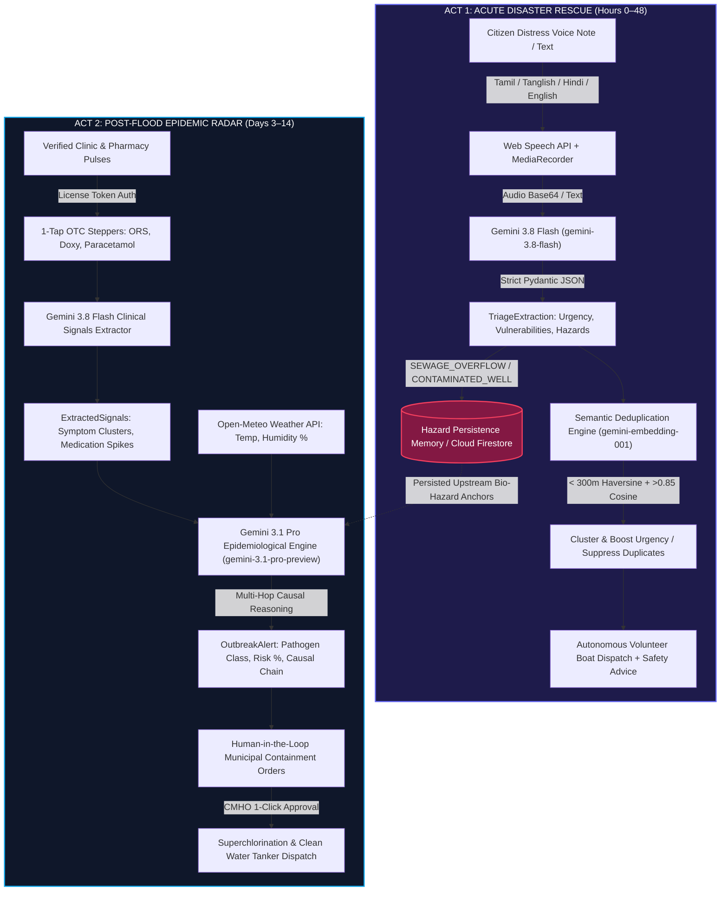
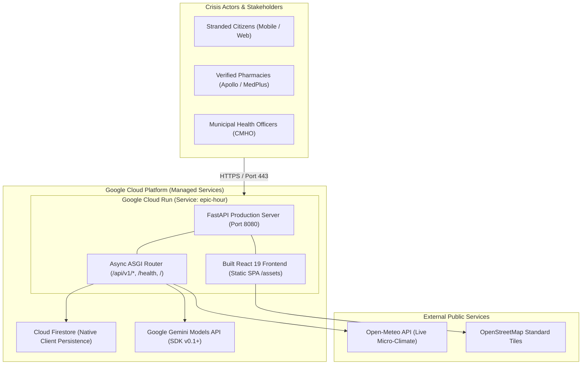

# EPIC-Hour
### Epidemic Prediction & Immediate Crisis Hour
> **A Two-Act Crisis Intelligence Platform Bridging Acute Disaster Rescue and Post-Flood Epidemic Outbreak Surveillance**

---

## 1. Executive Summary

Climate disasters claim lives in two distinct, sequential waves:
- **Wave 1 (Hours 0–48 — Acute Rescue):** Multilingual citizen SOS panic, emergency call congestion, duplicate rescue dispatches, and life-critical physical bottlenecks (elderly patients, dialysis needs, roof strandings).
- **Wave 2 (Days 3–14 — Post-Disaster Epidemics):** Submerged sewage networks and contaminated groundwater quietly incubate waterborne pathogens (*Vibrio cholerae*, acute gastroenteritis, leptospirosis). Hospitals only notice when inpatient wards overflow 10 days too late.

Existing disaster tools are disconnected: rescue trackers archive their data as soon as floodwaters recede, while municipal public health systems operate in silos.

**EPIC-Hour connects both phases into a unified, cloud-native causal intelligence pipeline.** Environmental hazards logged during Phase 1 acute rescues are preserved as **upstream bio-hazard anchors**. When neighborhood pharmacies log over-the-counter (OTC) medication rushes in Phase 2, Google Gemini cross-references the historical breach coordinates with live syndromic spikes to predict waterborne outbreaks up to 10 days before hospital admission spikes.

---

## 2. End-to-End System Architecture & Workflows

### Complete Two-Act Crisis Pipeline

```
                                  ACT 1: ACUTE DISASTER RESCUE (HOURS 0–48)
┌────────────────────────┐      ┌───────────────────────────┐      ┌──────────────────────────────┐
│  Citizen Emergency SOS │ ───► │  Gemini 3.8 Flash Triage  │ ───► │ 768-dim Semantic Dedup Engine│
│  • Voice note (Tamil/  │      │  • Urgency Score (1–10)   │      │ • gemini-embedding-001       │
│    English/Hindi)      │      │  • Vulnerabilities tags   │      │ • Haversine distance < 300m  │
│  • Live speech-to-text │      │  • Rescue resources       │      │ • Merges duplicate calls     │
│  • Landmark / GPS      │      │  • Environmental hazards  │      │ • Auto-boosts priority       │
└────────────────────────┘      └─────────────┬─────────────┘      └──────────────┬───────────────┘
                                              │                                   │
                                              ▼                                   ▼
                                ┌───────────────────────────┐      ┌──────────────────────────────┐
                                │ Hazard Persistence Memory │      │ Autonomous Dispatch Engine   │
                                │ • SEWAGE_OVERFLOW         │      │ • Nearest rescue boat match  │
                                │ • CONTAMINATED_WELL       │      │ • Volunteer ETA calculation  │
                                │ • STAGNANT_FLOODWATER     │      │ • Citizen safety guidance    │
                                └─────────────┬─────────────┘      └──────────────────────────────┘
                                              │
══════════════════════════════════════════════╪════════════════════════════════════════════════════════
                                              │
                                              ▼
                                 ACT 2: POST-FLOOD EPIDEMIC RADAR (DAYS 3–14)
┌────────────────────────┐      ┌───────────────────────────┐      ┌──────────────────────────────┐
│ Verified Clinic Pulse  │ ───► │ Upstream Causal Correlator│ ───► │ Human-in-the-Loop Municipal  │
│ • Authenticated badge  │      │ • Gemini 3.1 Pro          │      │   Containment Protocols      │
│ • 1-Tap OTC counters   │      │ • Phase 1 Bio-Hazards     │      │ • Superchlorination orders   │
│   (ORS, Doxycycline)   │      │ • Phase 2 OTC velocity    │      │ • Mobile clean water tankers │
│ • Dictated clinic note │      │ • Open-Meteo weather API  │      │ • Primary clinic restock     │
│ • Presenting patients  │      │ • Outbreak probability %  │      │ • CMHO 1-Click Authorization │
└────────────────────────┘      └───────────────────────────┘      └──────────────────────────────┘
```

### End-to-End Sequence & Intelligence Flow



### Google Cloud Run Fullstack Deployment Topology



---

## 3. Multi-Actor Role Architecture

EPIC-Hour delivers three purpose-built portals engineered for distinct crisis stakeholders:

### 1. Citizen Emergency SOS Portal (`CitizenSOSPortal.jsx`)
- **Frictionless & Zero-Login:** Stranded citizens or bystanders can report life-threatening emergencies instantly.
- **Multimodal Voice & Real-Time Dictation:** Dual-mode browser speech capture runs speech recognition alongside audio recording. As the citizen speaks in Tamil, English, Hindi, or mixed vernacular, the transcript streams into the emergency description box in real time.
- **Integrated Audio Playback Bar:** Displays an audio playback player with duration counter and re-record controls to review the voice distress note.
- **Immediate Reassurance & Telemetry:** Upon submission, citizens immediately receive a prioritized dispatch ticket, assigned volunteer boat details, live ETA, and emergency safety guidance.

### 2. Verified Clinic & Pharmacy Pulse Portal (`PharmacyPulsePortal.jsx`)
- **Anti-Poisoning Authentication:** Enforces verified facility and cryptographic license token validation to prevent fabricated data submissions.
- **1-Tap Syndromic Counters:** Fast stepper inputs for daily presenting patient counts alongside instant stockout toggles for frontline emergency medications:
  - **ORS Packets** (Acute diarrhea / dehydration)
  - **Doxycycline** (Waterborne bacterial enteritis protocol)
  - **Paracetamol** (Acute febrile illness)
- **Clinical Dictation Bar:** Allows pharmacists and community health workers to record audio observations with live speech-to-text and playback verification.
- **Zero PII Exposure:** Collects strictly aggregate syndromic trends, protecting patient confidentiality while delivering high-velocity epidemiological signals.

### 3. Municipal Command Center (`CommandCenter.jsx`)
- **Geospatial Tactical Map (`EpicHourMap.jsx`):** Interactive tactical canvas displaying active citizen rescue clusters, field volunteer boats, verified healthcare nodes, and persisted sewage breach points.
- **Bidirectional Wave / Timeline Synchronization:**
  - Selecting **Wave 1: Flood Rescue** locks the timeline to **Day 1 (Acute Flood)**, highlighting acute rescues, P0 critical evacuations, and deployed rescue boats.
  - Selecting **Wave 2: Outbreak Radar** locks the timeline to **Day 5 (Post-Flood)**, illuminating persistent bio-hazard breach anchors, pharmacy surge telemetry (+380% surge), and outbreak probability.
- **Single Source of Truth Metric Engine:** All statistics displayed in the bottom metric cards (Presenting Patients, Bio-Hazard Anchors, Reporting Network) and the epidemiological reasoning text are derived from dynamic state calculations, guaranteeing zero mathematical contradictions.
- **Human-in-the-Loop Action Approval (`EpidemicReasoningCard.jsx`):** Synthesizes Gemini 3.1 Pro causal reasoning into legally actionable municipal orders (Superchlorination, Clean Water Tanker Deployments, Clinic Depot Restocks) with one-click authorization by the Chief Municipal Health Officer.

---

## 4. Google AI Models & Engineering Specifications

EPIC-Hour uses a targeted model hierarchy configured through the official `google-genai` Python SDK:

| Model | Purpose | Why This Model | Failover / Quota Resilience Hierarchy |
|---|---|---|---|
| **`gemini-3.8-flash`** | **Multimodal Audio STT & SOS Triage** | Ultra-low latency (< 1.2s), native multimodal audio byte comprehension across Indian vernaculars (Tamil, Hindi, Tanglish, English). Strict JSON schema enforcement (`TriageExtraction`). | Fallback: `gemini-flash-latest` → Deterministic regex & keyword triage heuristics. |
| **`gemini-embedding-001`** | **768-dim Semantic Deduplication** | High-dimensional geometric representation capturing semantic equivalence between varied frantic phrasing (e.g., *"grandpa stuck with water inside"* vs. *"elderly patient flooded"*). | Fallback: Deterministic n-gram and character trigram hash vectorizer. |
| **`gemini-3.1-pro-preview`** | **Spatio-Temporal Causal Outbreak Reasoning** | Advanced multi-hop causal graph reasoning correlating historical Phase 1 sewage breach anchors with Phase 2 pharmacy OTC rushes, formulating concrete municipal containment protocols. | Fallback: `gemini-pro-latest` → `gemini-3.8-flash` (auto rate-limit handling) → Deterministic epidemiological model. |

### Architectural Resilience Guarantee:
- **100% Demo Uptime:** If `GEMINI_API_KEY` is not configured, or if quota limits (`429 RESOURCE_EXHAUSTED`) are reached, local deterministic models seamlessly take over.
- **Hazard Persistence Memory:** Bio-hazard tags (`SEWAGE_OVERFLOW`, `CONTAMINATED_WELL`, `STAGNANT_FLOODWATER`) recorded during Phase 1 acute rescues are permanently stored in Cloud Firestore and are never purged when rescues conclude.
- **PII Scrubbing:** Citizen phone numbers are SHA-256 hashed before storage or processing.

---

## 5. Technology Stack

| Layer | Technologies & Libraries | Architectural Purpose |
|---|---|---|
| **Frontend Framework** | **React 19**, Vite 8 | High-performance reactive UI rendering |
| **Design System** | Custom Superhuman Design Tokens, Tailwind CSS v4 | Warm surface palette (`#f7f5f2`), deep indigo `#1b1938`, frosted glass cards |
| **Tactical Cartography** | **Leaflet**, `react-leaflet`, OpenStreetMap Standard | Fast, reliable live geospatial telemetry without external API key dependencies |
| **Audio & Speech UX** | `MediaRecorder` API, Web Speech API (`SpeechRecognition`) | Live vernacular speech-to-text transcription and audio playback |
| **Icons & Typography** | `lucide-react`, Plus Jakarta Sans, Inter Variable | Modern, accessible typographic hierarchy |
| **Backend Framework** | **Python 3.11 / 3.13**, **FastAPI**, Uvicorn | Async, low-latency RESTful microservices |
| **Multimodal Triage AI** | **Google Gemini 3.8 Flash** (`gemini-3.8-flash`) | Multilingual voice/text parsing, strict JSON schema extraction |
| **Semantic De-duplication**| **Google Gemini Embedding-001** (`gemini-embedding-001`) | 768-dim cosine similarity clustering for duplicate emergency suppression |
| **Epidemiological AI** | **Google Gemini 3.1 Pro** (`gemini-3.1-pro-preview`) | Spatio-temporal causal reasoning and structured municipal action synthesis |
| **Weather Telemetry** | **Open-Meteo API** | Real-time ambient humidity, precipitation, and temperature correlation |
| **Data Persistence** | **Google Cloud Firestore** (Native) + Stateful In-Memory Fallback | Cloud persistence with resilient offline fallback for zero demo downtime |
| **Cloud Deployment** | **Google Cloud Run** + **Google Cloud Build** | Fully managed containerized serverless hosting on Google Cloud |

---

## 6. API Specification (`/api/v1/`)

| Method | Endpoint | Request Body / Parameters | Description |
|---|---|---|---|
| `GET` | `/` | — | Serves the production React Single Page Application (or system status if SPA not built). |
| `GET` | `/health` | — | Health check returning active tickets, pulses, simulated day, and uptime status. |
| `GET` | `/api/info` | — | System metadata, AI model status, and API documentation link. |
| `GET` | `/api/v1/state` | `?ward_id=WARD_14` | Retrieves complete system state: active tickets, verified facilities, pulses, weather, and outbreak alerts. |
| `POST` | `/api/v1/sos/ingest` | `text`, `audio_b64`, `audio_mime`, `address`, `phone` | Ingests citizen SOS, executes Gemini 3.8 Flash triage, hashes PII, performs 768-dim dedup, and assigns nearest volunteer. |
| `POST` | `/api/v1/audio/transcribe` | `audio_b64`, `audio_mime`, `context` | Multimodal speech-to-text fallback for English, Tamil, Hindi, and mixed vernacular. |
| `GET` | `/api/v1/sos/active` | — | Returns all active, unresolved Phase 1 citizen rescue tickets. |
| `GET` | `/api/v1/facilities/verified` | — | Returns verified neighborhood pharmacies and clinic facilities. |
| `POST` | `/api/v1/surveillance/pulse` | `facility_id`, `license_token`, `otc_counts`, `stockouts`, `estimated_patient_count`, `text`, `audio_b64` | Ingests verified pharmacy pulse, validates license token, extracts syndromic signals, and triggers Gemini 3.1 Pro outbreak correlation. |
| `GET` | `/api/v1/surveillance/heatmap` | `?phase=1\|2&ward_id=WARD_14` | Returns GeoJSON FeatureCollection of spatial hazards, rescue tickets, and pharmacy pulse clusters. |
| `POST` | `/api/v1/action/approve` | `action_id`, `approver_name`, `notes` | Human-in-the-Loop protocol: Authorizes and signs a proposed municipal containment action. |
| `POST` | `/api/v1/auth/login` | `role`, `identifier`, `password` | RBAC authentication for Municipal Crisis Commanders and Verified Pharmacy Partners. |
| `POST` | `/api/v1/demo/simulate-day` | `day: 1 \| 5` | Scenario switcher: Day 1 (Acute Flood) vs. Day 5 (Post-Flood Outbreak Surge). |

---

## 7. Repository Structure

```text
Epic-AiBuilder/
├── Dockerfile                               # Multi-Stage Dockerfile (Node.js Build + FastAPI Production)
├── .dockerignore                            # Excludes node_modules, cache, and local logs from Docker
├── .gcloudignore                            # Excludes local artifacts for fast Cloud Build upload
├── deploy-cloudrun.ps1                      # Windows PowerShell 1-Click Cloud Run Deployment Script
├── deploy-cloudrun.sh                       # Linux / macOS Bash Cloud Run Deployment Script
│
├── frontend/                                # React 19 Frontend Application
│   ├── public/
│   │   └── favicon.svg                      # Civic Shield SVG Favicon
│   ├── src/
│   │   ├── components/
│   │   │   ├── AppHeader.jsx                # Navigation & Role Switcher
│   │   │   ├── EpicHourLogo.jsx             # Platform Brand Logo
│   │   │   ├── CitizenSOSPortal.jsx         # Portal 1: Voice/Text SOS + Audio Player + Live STT
│   │   │   ├── PharmacyPulsePortal.jsx      # Portal 2: Verified Pharmacy OTC Steppers + Voice Dictation
│   │   │   ├── CommandCenter.jsx            # Portal 3: Municipal Ops Dashboard (Wave 1 & Wave 2)
│   │   │   ├── EpicHourMap.jsx              # OpenStreetMap Tactical Cartography
│   │   │   ├── EpidemicReasoningCard.jsx    # Causal Graph Reasoning & Action Authorization
│   │   │   └── LoginModal.jsx               # RBAC Authentication Modal
│   │   ├── hooks/
│   │   │   └── useMediaRecorder.js          # Dual MediaRecorder + Web Speech API Hook
│   │   ├── services/
│   │   │   └── api.js                       # Axios Client with Auto Relative URL in Production
│   │   ├── lib/
│   │   │   ├── firebase.js                  # Cloud Firestore Direct Integration
│   │   │   └── mockData.js                  # Ward 14 Ground Truth Dataset
│   │   ├── index.css                        # Design System CSS Variables & Tokens
│   │   └── App.jsx                          # Root Application Container & State Orchestrator
│   ├── package.json                         # Frontend Dependencies
│   └── vite.config.js                       # Vite Build Configuration
│
├── backend/                                 # FastAPI Backend Application
│   ├── data/
│   │   └── mock_dataset.json                # Ward 14 Ground Truth Scenarios (Day 1 & Day 5)
│   ├── models/
│   │   ├── auth_schema.py                   # Authentication Models & Role Definitions
│   │   ├── sos_schema.py                    # SOSTicket, TriageExtraction, Location Schemas
│   │   └── surveillance_schema.py           # PharmacyPulse, OutbreakAlert, MunicipalAction
│   ├── services/
│   │   ├── gemini_flash.py                  # Gemini 3.8 Flash Multimodal STT & Triage
│   │   ├── gemini_pro.py                    # Gemini 3.1 Pro Spatio-Temporal Correlation
│   │   ├── embeddings.py                    # gemini-embedding-001 768-dim Semantic Deduplication
│   │   ├── geocoding.py                     # Landmark Geocoding & Weather Telemetry
│   │   └── state_store.py                   # Firestore Native Repository with In-Memory Fallback
│   ├── main.py                              # FastAPI Routes, Static SPA Mount, and Endpoints
│   ├── requirements.txt                     # Backend Dependencies (FastAPI, Google GenAI, Uvicorn)
│   ├── .env.example                         # Environment Variables Template
│   └── .env                                 # Local Configuration (Git-Ignored)
│
├── .gitignore                               # Git Ignore Configuration
├── README.md                                # Project Documentation
└── CLAUDE.md                                # Architecture & Developer Guide
```

---

## 8. Quickstart & Local Setup

### Prerequisites
- **Node.js** (v18 or higher) & **npm**
- **Python** (v3.11 or higher)

### Step 1: Configure Environment Variables
Create `.env` from `.env.example` in both directories:
```bash
# In backend/
cp backend/.env.example backend/.env

# In frontend/
cp frontend/.env.example frontend/.env
```
*(Optional: Provide `GEMINI_API_KEY` in `backend/.env`. If omitted, EPIC-Hour automatically runs in its deterministic fallback mode with full feature availability).*

### Step 2: Start Backend Service (Port 8000)
```bash
cd backend
python -m pip install -r requirements.txt
python -m uvicorn main:app --reload --port 8000
```
- API Base: `http://localhost:8000`
- Interactive API Documentation: `http://localhost:8000/docs`

### Step 3: Start Frontend Application (Port 5173)
In a separate terminal:
```bash
cd frontend
npm install
npm run dev
```
- Web Application: `http://localhost:5173`

---

## 9. Google Cloud Run Deployment (Production)

EPIC-Hour uses a unified multi-stage container architecture: Vite compiles the React single-page application into production assets, and FastAPI serves both the static web frontend and all backend REST endpoints on Cloud Run's `$PORT` (default 8080).

### Method 1: 1-Click Deployment Script

```powershell
# Windows PowerShell:
.\deploy-cloudrun.ps1
```

```bash
# Linux / macOS / Git Bash:
chmod +x deploy-cloudrun.sh
./deploy-cloudrun.sh
```

### Method 2: Manual Deployment via `gcloud` CLI

```bash
gcloud run deploy epic-hour \
    --source . \
    --project epichour-512012 \
    --region asia-south1 \
    --platform managed \
    --allow-unauthenticated \
    --set-env-vars "MOCK_MODE=false"
```

*(To pass a Gemini API key to Cloud Run, append `--set-env-vars "GEMINI_API_KEY=YOUR_KEY,MOCK_MODE=false"`).*

### Live Cloud Run Production Endpoints

* **Web Application & Interactive Portals:** `https://epic-hour-83369227014.asia-south1.run.app`
* **Direct Regional Gateway:** `https://epic-hour-xa6bnoi2va-el.a.run.app`
* **Health Endpoint:** `https://epic-hour-83369227014.asia-south1.run.app/health`
* **API Documentation (Swagger):** `https://epic-hour-83369227014.asia-south1.run.app/docs`

---

## 10. Live Demonstration Guide

To explore the two-phase crisis intelligence lifecycle:

1. **Citizen Distress SOS (Wave 1):**
   - Open the **Citizen SOS** portal.
   - Click **Record voice note** and speak an emergency (or select the *"Medical & Dialysis"* preset).
   - Watch the live speech transcript stream into the emergency description box in real time.
   - Review your recorded audio in the audio player.
   - Click **Request immediate rescue** to view real-time triage scoring (`gemini-3.8-flash`), 768-dim semantic deduplication (`gemini-embedding-001`), and volunteer boat dispatch.

2. **Clinic Syndromic Pulse (Wave 2):**
   - Switch to **Clinic Pulse** in the top navigation.
   - Adjust the patient counter, toggle an **ORS Packets** stockout, and dictate clinical notes via the voice recorder.
   - Click **Submit daily pulse** to feed syndromic velocity into municipal surveillance.

3. **Municipal Crisis Command:**
   - Switch to **Command & Map** to enter the command center.
   - Select **Day 1 (Acute Flood)** to inspect active water rescues, P0 medical emergencies, and volunteer squads.
   - Select **Day 5 (Post-Flood)** to observe the automatic switch to **Wave 2: Outbreak Radar**:
     - View the dynamic correlation linking Phase 1 sewage breach anchors to the +380% clinic surge (257 patients).
     - Inspect the proposed municipal containment actions generated by `gemini-3.1-pro-preview`.
     - Click **Authorize & Dispatch Order** to sign mobile water superchlorination orders.
